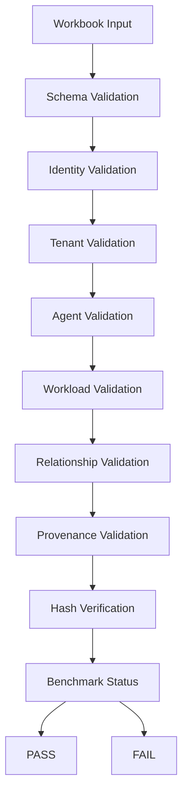
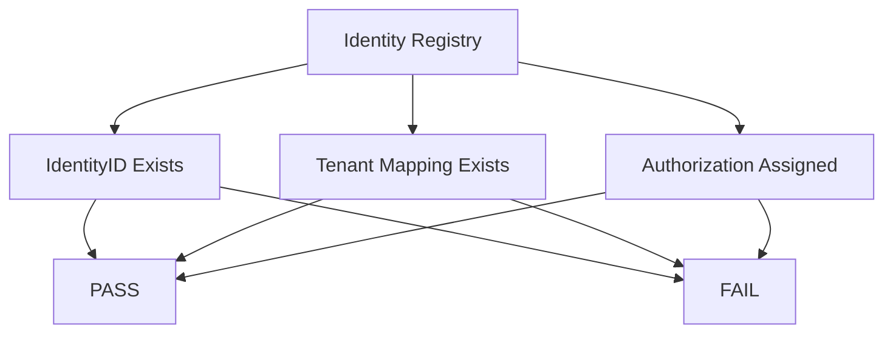
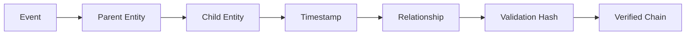
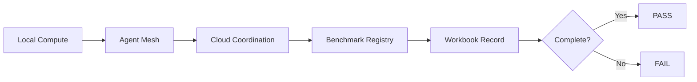
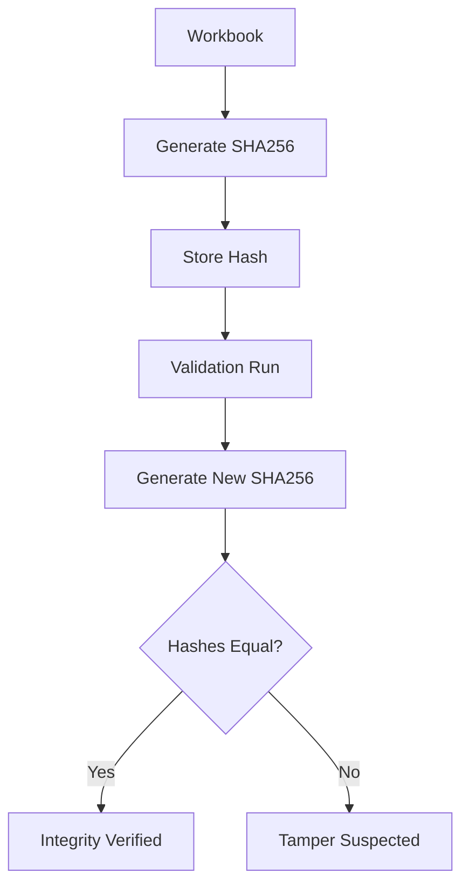

Add the following sections to the README.

---

# Validation Architecture (Mermaid)

## End-to-End Validation Pipeline



---

## Identity Graph Validation



---

## Provenance Chain Validation



---

## Workload Routing Validation



---

## Cryptographic Integrity Flow



---

# CSV Schema Templates

---

## tenants.csv

```csv
TenantID,TenantName,Region,Status,OwnerIdentity,CreationDate
tenant-001,Contoso,US-East,Active,id-001,2026-01-01
```

---

## identities.csv

```csv
IdentityID,DisplayName,UPN,Role,TenantID,Status
id-001,Alexandre Pedrosa,alex@tenant.com,Architect,tenant-001,Active
```

---

## agents.csv

```csv
AgentID,AgentName,AgentType,Version,ExecutionScope,Status
agent-001,M365 Copilot,Agent,v1.0,Cloud,Active
```

---

## workloads.csv

```csv
WorkloadID,OriginNode,TargetNode,ExecutionType,DurationMS,Status
wl-001,WindowsNode,AzureNode,Inference,340,Completed
```

---

## provenance.csv

```csv
ProvenanceID,ParentEntity,ChildEntity,EventType,Timestamp
prov-001,wl-001,agent-001,GENERATED,2026-10-21T10:00:00Z
```

---

## relationships.csv

```csv
RelationshipID,SourceNode,TargetNode,RelationshipType,Weight
rel-001,id-001,agent-001,OWNS,1.0
```

---

# SHA256 Manifest

## manifest.sha256

```text
41dd6a65015177332cf55f6f6994f4dae7cc0995c49f887c7df4e4d925700352 tenants.csv

7c9582df67d3fc4c8af0b8f8d1284ec5c9c1f23a317784a2ec1552dc8a2f67de identities.csv

51e6645c7d477d8d962df287ce417a74226e9a6d0f5ea18284d888fffbe67155 agents.csv

0f986cad26357fd30d29467f1015480f8d3a6fb54f638e388f71baf2b7fb6f6e workloads.csv

ee29e1afba9f4320c42201184fdbd54e2ca2436f88364aadec0734f816f4acf9 provenance.csv

2b1ec9bcf5ef715af39d66f0d98348bb05fd2ee8498f1ce5999fd6de6da34d83 relationships.csv
```

---

# Hash Generation

## PowerShell

```powershell
Get-FileHash .\tenants.csv -Algorithm SHA256

Get-FileHash .\identities.csv -Algorithm SHA256

Get-FileHash .\agents.csv -Algorithm SHA256

Get-FileHash .\workloads.csv -Algorithm SHA256

Get-FileHash .\provenance.csv -Algorithm SHA256

Get-FileHash .\relationships.csv -Algorithm SHA256
```

---

## Linux

```bash
sha256sum tenants.csv

sha256sum identities.csv

sha256sum agents.csv

sha256sum workloads.csv

sha256sum provenance.csv

sha256sum relationships.csv
```

---

# Automated Validation Script (PowerShell)

```powershell
$Files = @(
    "tenants.csv",
    "identities.csv",
    "agents.csv",
    "workloads.csv",
    "provenance.csv",
    "relationships.csv"
)

foreach ($File in $Files)
{
    if(Test-Path $File)
    {
        Write-Host "[PASS] $File exists"
    }
    else
    {
        Write-Host "[FAIL] $File missing"
    }
}
```

---

# Identity Validation Script

```powershell
$IdentityTable = Import-Csv .\identities.csv

$Duplicates = $IdentityTable |
Group-Object IdentityID |
Where-Object {$_.Count -gt 1}

if($Duplicates.Count -eq 0)
{
    Write-Host "PASS - Identity uniqueness confirmed"
}
else
{
    Write-Host "FAIL - Duplicate identities detected"
}
```

---

# Tenant Validation Script

```powershell
$Tenants = Import-Csv .\tenants.csv

foreach($Tenant in $Tenants)
{
    if(:IsNullOrWhiteSpace($Tenant.TenantID))
    {
        Write-Host "FAIL Missing TenantID"
    }
}
```

---

# Provenance Validation Script

```powershell
$Events = Import-Csv .\provenance.csv

foreach($Item in $Events)
{
    if(
        :IsNullOrWhiteSpace($Item.ParentEntity)
        -or
        :IsNullOrWhiteSpace($Item.ChildEntity)
    )
    {
        Write-Host "FAIL Provenance Break"
    }
}
```

---

# Relationship Graph Validator

```powershell
$Relationships = Import-Csv .\relationships.csv

foreach($R in $Relationships)
{
    if(
        :IsNullOrWhiteSpace($R.SourceNode)
        -or
        :IsNullOrWhiteSpace($R.TargetNode)
    )
    {
        Write-Host "FAIL Invalid Relationship"
    }
}
```

---

# Full Mesh Validation

```powershell
Write-Host "================================="
Write-Host "WINDOWS AGI MESH VALIDATION"
Write-Host "================================="

.\Validate-Files.ps1
.\Validate-Identity.ps1
.\Validate-Tenants.ps1
.\Validate-Provenance.ps1
.\Validate-Relationships.ps1

Write-Host "Validation Complete"
```

---

# Benchmark Compliance Levels

```text
LEVEL 0
Raw Workbook

LEVEL 1
Workbook + Schema

LEVEL 2
Workbook + Schema + Hashes

LEVEL 3
Workbook + Schema + Provenance

LEVEL 4
Workbook + Graph Validation

LEVEL 5
Workbook + Agent Validation

LEVEL 6
Fully Validated Windows AGI Mesh Benchmark
```

---
Add the following sections to the README.

---

# Validation Architecture (Mermaid)

## End-to-End Validation Pipeline


---

## Identity Graph Validation


---

## Provenance Chain Validation


---

## Workload Routing Validation


---

## Cryptographic Integrity Flow


---

# CSV Schema Templates

---

## tenants.csv

```csv
TenantID,TenantName,Region,Status,OwnerIdentity,CreationDate
tenant-001,Contoso,US-East,Active,id-001,2026-01-01
```

---

## identities.csv

```csv
IdentityID,DisplayName,UPN,Role,TenantID,Status
id-001,Alexandre Pedrosa,alex@tenant.com,Architect,tenant-001,Active
```

---

## agents.csv

```csv
AgentID,AgentName,AgentType,Version,ExecutionScope,Status
agent-001,M365 Copilot,Agent,v1.0,Cloud,Active
```

---

## workloads.csv

```csv
WorkloadID,OriginNode,TargetNode,ExecutionType,DurationMS,Status
wl-001,WindowsNode,AzureNode,Inference,340,Completed
```

---

## provenance.csv

```csv
ProvenanceID,ParentEntity,ChildEntity,EventType,Timestamp
prov-001,wl-001,agent-001,GENERATED,2026-10-21T10:00:00Z
```

---

## relationships.csv

```csv
RelationshipID,SourceNode,TargetNode,RelationshipType,Weight
rel-001,id-001,agent-001,OWNS,1.0
```

---

# SHA256 Manifest

## manifest.sha256

```text
41dd6a65015177332cf55f6f6994f4dae7cc0995c49f887c7df4e4d925700352 tenants.csv

7c9582df67d3fc4c8af0b8f8d1284ec5c9c1f23a317784a2ec1552dc8a2f67de identities.csv

51e6645c7d477d8d962df287ce417a74226e9a6d0f5ea18284d888fffbe67155 agents.csv

0f986cad26357fd30d29467f1015480f8d3a6fb54f638e388f71baf2b7fb6f6e workloads.csv

ee29e1afba9f4320c42201184fdbd54e2ca2436f88364aadec0734f816f4acf9 provenance.csv

2b1ec9bcf5ef715af39d66f0d98348bb05fd2ee8498f1ce5999fd6de6da34d83 relationships.csv
```

---

# Hash Generation

## PowerShell

```powershell
Get-FileHash .\tenants.csv -Algorithm SHA256

Get-FileHash .\identities.csv -Algorithm SHA256

Get-FileHash .\agents.csv -Algorithm SHA256

Get-FileHash .\workloads.csv -Algorithm SHA256

Get-FileHash .\provenance.csv -Algorithm SHA256

Get-FileHash .\relationships.csv -Algorithm SHA256
```

---

## Linux

```bash
sha256sum tenants.csv

sha256sum identities.csv

sha256sum agents.csv

sha256sum workloads.csv

sha256sum provenance.csv

sha256sum relationships.csv
```

---

# Automated Validation Script (PowerShell)

```powershell
$Files = @(
    "tenants.csv",
    "identities.csv",
    "agents.csv",
    "workloads.csv",
    "provenance.csv",
    "relationships.csv"
)

foreach ($File in $Files)
{
    if(Test-Path $File)
    {
        Write-Host "[PASS] $File exists"
    }
    else
    {
        Write-Host "[FAIL] $File missing"
    }
}
```

---

# Identity Validation Script

```powershell
$IdentityTable = Import-Csv .\identities.csv

$Duplicates = $IdentityTable |
Group-Object IdentityID |
Where-Object {$_.Count -gt 1}

if($Duplicates.Count -eq 0)
{
    Write-Host "PASS - Identity uniqueness confirmed"
}
else
{
    Write-Host "FAIL - Duplicate identities detected"
}
```

---

# Tenant Validation Script

```powershell
$Tenants = Import-Csv .\tenants.csv

foreach($Tenant in $Tenants)
{
    if(:IsNullOrWhiteSpace($Tenant.TenantID))
    {
        Write-Host "FAIL Missing TenantID"
    }
}
```

---

# Provenance Validation Script

```powershell
$Events = Import-Csv .\provenance.csv

foreach($Item in $Events)
{
    if(
        :IsNullOrWhiteSpace($Item.ParentEntity)
        -or
        :IsNullOrWhiteSpace($Item.ChildEntity)
    )
    {
        Write-Host "FAIL Provenance Break"
    }
}
```

---

# Relationship Graph Validator

```powershell
$Relationships = Import-Csv .\relationships.csv

foreach($R in $Relationships)
{
    if(
        :IsNullOrWhiteSpace($R.SourceNode)
        -or
        :IsNullOrWhiteSpace($R.TargetNode)
    )
    {
        Write-Host "FAIL Invalid Relationship"
    }
}
```

---

# Full Mesh Validation

```powershell
Write-Host "================================="
Write-Host "WINDOWS AGI MESH VALIDATION"
Write-Host "================================="

.\Validate-Files.ps1
.\Validate-Identity.ps1
.\Validate-Tenants.ps1
.\Validate-Provenance.ps1
.\Validate-Relationships.ps1

Write-Host "Validation Complete"
```

---

# Benchmark Compliance Levels

```text
LEVEL 0
Raw Workbook

LEVEL 1
Workbook + Schema

LEVEL 2
Workbook + Schema + Hashes

LEVEL 3
Workbook + Schema + Provenance

LEVEL 4
Workbook + Graph Validation

LEVEL 5
Workbook + Agent Validation

LEVEL 6
Fully Validated Windows AGI Mesh Benchmark
```

---

## Reproducibility Statement

Every benchmark artifact should be reproducible through:

```text
Schema Validation
+
Identity Verification
+
Relationship Verification
+
Provenance Validation
+
Hash Verification
+
Graph Consistency Checks
```

This establishes a durable, auditable graph-provenance benchmark capable of preserving workload lineage, identity relationships, agent participation records, and benchmark integrity across the Windows AGI Mesh ecosystem.

## Reproducibility Statement

Every benchmark artifact should be reproducible through:

```text
Schema Validation
+
Identity Verification
+
Relationship Verification
+
Provenance Validation
+
Hash Verification
+
Graph Consistency Checks
```

This establishes a durable, auditable graph-provenance benchmark capable of preserving workload lineage, identity relationships, agent participation records, and benchmark integrity across the Windows AGI Mesh ecosystem.
